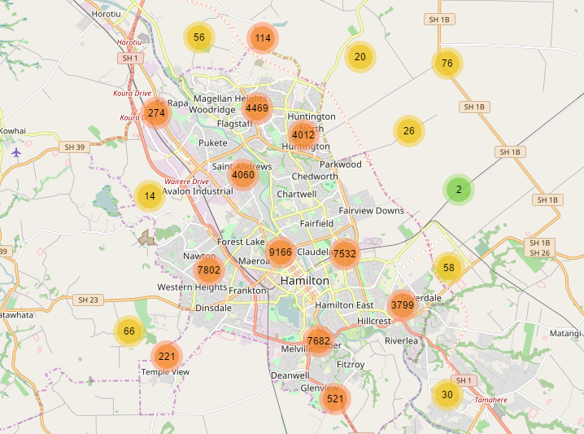

# Leaflet.markercluster

Fast, animated marker clustering for [Leaflet](https://leafletjs.com) (2.0 and 1.9), ready for hundreds of thousands of markers.



**[See the demos](https://leaflet.github.io/Leaflet.markercluster/example/)**

Version 2.0 is in beta: install it with `npm install leaflet.markercluster@next`, and please report any problems in [#1115](https://github.com/Leaflet/Leaflet.markercluster/issues/1115). See the [changelog](CHANGELOG.md) for what changed since 1.5. For Leaflet 1.0–1.8, use [1.5.3](https://github.com/Leaflet/Leaflet.markercluster/tree/v1.5.3).

[Getting started](#getting-started) · [Options](#options) · [Events](#events) · [Methods](#methods) · [Accessibility](#accessibility) · [TypeScript](#typescript) · [Plugins](#plugins) · [Development](#development)

## Getting started

Install the plugin with `npm install leaflet.markercluster@next`, along with `leaflet@beta` for Leaflet 2.0 or `leaflet` for 1.9. The examples below work with both.

Create a `MarkerClusterGroup`, add markers to it and add it to the map:

```js
import * as L from 'leaflet';
import {MarkerClusterGroup} from 'leaflet.markercluster';
import 'leaflet.markercluster/dist/MarkerCluster.Default.css';

const map = new L.Map('map').setView([-37.82, 175.24], 13);
new L.TileLayer('https://tile.openstreetmap.org/{z}/{x}/{y}.png').addTo(map);

const markers = new MarkerClusterGroup();
markers.addLayers(latlngs.map(latlng => new L.Marker(latlng)));
map.addLayer(markers);
```

`MarkerCluster.Default.css` styles the default cluster icons. You don't need it if you make your own with [`iconCreateFunction`](#custom-cluster-icons).

### In the browser without a build step

The plugin is an ES module that imports `leaflet`, so an [import map](https://developer.mozilla.org/en-US/docs/Web/HTML/Reference/Elements/script/type/importmap) tells the browser where to find both:

```html
<link rel="stylesheet" href="https://cdn.jsdelivr.net/npm/leaflet@2.0.0-beta.4/dist/leaflet.css">
<link rel="stylesheet" href="https://cdn.jsdelivr.net/npm/leaflet.markercluster@2.0.0-beta.2/dist/MarkerCluster.Default.css">
<script type="importmap">
{
	"imports": {
		"leaflet": "https://cdn.jsdelivr.net/npm/leaflet@2.0.0-beta.4/dist/leaflet.js",
		"leaflet.markercluster": "https://cdn.jsdelivr.net/npm/leaflet.markercluster@2.0.0-beta.2/dist/leaflet.markercluster.js"
	}
}
</script>
<script type="module">
	import * as L from 'leaflet';
	import {MarkerClusterGroup} from 'leaflet.markercluster';
	// ...
</script>
```

For Leaflet 1.9, point `leaflet` to `https://cdn.jsdelivr.net/npm/leaflet@1.9.4/dist/leaflet-src.esm.js`.

### As a plain script

`dist/leaflet.markercluster-global.js` works with Leaflet's global build, with no modules involved. Load it after Leaflet and use `L.MarkerClusterGroup`. This example uses Leaflet 1.9:

```html
<link rel="stylesheet" href="https://cdn.jsdelivr.net/npm/leaflet@1.9.4/dist/leaflet.css">
<link rel="stylesheet" href="https://cdn.jsdelivr.net/npm/leaflet.markercluster@2.0.0-beta.2/dist/MarkerCluster.Default.css">
<script src="https://cdn.jsdelivr.net/npm/leaflet@1.9.4/dist/leaflet.js"></script>
<script src="https://cdn.jsdelivr.net/npm/leaflet.markercluster@2.0.0-beta.2/dist/leaflet.markercluster-global.js"></script>
<script>
	const markers = new L.MarkerClusterGroup();
</script>
```

On Leaflet 2.0, load `leaflet-global.js` instead of `leaflet.js`. Only Leaflet 1.9 gets the `L.markerClusterGroup()` factory.

## Options

Pass options when creating the group, e.g. `new MarkerClusterGroup({maxClusterRadius: 60, showCoverageOnHover: false})`.

### Clustering

| Option | Default | Description |
| --- | --- | --- |
| `maxClusterRadius` | `80` | The maximum distance in pixels from a cluster's center to its markers. Smaller values make more, smaller clusters. Can be a function that takes a zoom and returns the radius for it. |
| `disableClusteringAtZoom` | `null` | Don't cluster markers at this zoom and above ([demo](https://leaflet.github.io/Leaflet.markercluster/example/marker-clustering-realworld-maxzoom.388.html)). You may want to turn off `spiderfyOnMaxZoom` with it. |
| `removeOutsideVisibleBounds` | `true` | Take clusters and markers far from the view off the map, for performance. |
| `singleMarkerMode` | `false` | Give single markers the cluster icon too, as clusters of 1. Only the icon changes, so the markers keep their events, and the icon stays at zooms where clustering is disabled. |

### Clicking clusters

| Option | Default | Description |
| --- | --- | --- |
| `zoomToBoundsOnClick` | `true` | Zoom to a cluster's markers when it's clicked. |
| `spiderfyOnMaxZoom` | `true` | Spread out a cluster's markers when it's clicked and zooming in wouldn't split it: at the bottom zoom, or when its markers stay together down to it. |
| `spiderfyOnEveryZoom` | `false` | Spread out a cluster's markers when it's clicked at any zoom. |
| `showCoverageOnHover` | `true` | Show the area covered by a cluster's markers on hover or keyboard focus. |
| `polygonOptions` | `{}` | [Path options](https://leafletjs.com/reference.html#path-option) for that coverage polygon. |

### Appearance

| Option | Default | Description |
| --- | --- | --- |
| `iconCreateFunction` | | Creates the icon of a cluster, see [custom cluster icons](#custom-cluster-icons). The default shows the marker count in a circle that changes color at 10 and 100. |
| `clusterLabel` | `` c => `${c.getChildCount()} markers` `` | Returns the name screen readers announce for a cluster, e.g. to translate it. |
| `clusterPane` | `'markerPane'` | The [map pane](https://leafletjs.com/reference.html#map-pane) for clusters ([demo](https://leaflet.github.io/Leaflet.markercluster/example/marker-clustering-pane.html)). |
| `spiderLegPolylineOptions` | `{weight: 1.5, color: '#222', opacity: 0.5}` | [Polyline options](https://leafletjs.com/reference.html#polyline-option) for the legs of spread-out markers. |
| `spiderfyDistanceMultiplier` | `1` | Scales how far spread-out markers are from the center, e.g. for big icons. |
| `spiderfyShapePositions` | `null` | Places spread-out markers in a shape of your own, see [below](#custom-spiderfy-shapes). |

### Animation

| Option | Default | Description |
| --- | --- | --- |
| `animate` | `true` | Animate clusters splitting and merging on zoom, and markers spreading out. |
| `animationDuration` | `300` | How long those animations take, in milliseconds. |
| `animateAddingMarkers` | `false` | Animate markers into their clusters when added with `addLayer` while the group is on the map. It's slow for many markers, and `addLayers` never animates. |

With `prefers-reduced-motion`, animations fade instead of moving.

### Chunked loading

`addLayers` takes about 0.4 s for 200k markers on a desktop. To keep the page responsive while adding even more, or on slow devices, split the work into chunks:

| Option | Default | Description |
| --- | --- | --- |
| `chunkedLoading` | `false` | Split `addLayers` into chunks with breaks in between, so that the page doesn't freeze. |
| `chunkInterval` | `200` | Milliseconds of work per chunk. |
| `chunkDelay` | `50` | Milliseconds between chunks. |
| `chunkProgress` | `null` | Called after each chunk with the number of markers processed, the total, and the milliseconds since the start, e.g. for a progress bar ([demo](https://leaflet.github.io/Leaflet.markercluster/example/marker-clustering-realworld.50000.html)). The total grows when `addLayers` finds a layer group in the array, so the progress can jump back. |

### Custom cluster icons

`iconCreateFunction` gets a cluster and returns an icon for it. Use `getChildCount()` or `getAllChildMarkers()` to decide what to show ([demo](https://leaflet.github.io/Leaflet.markercluster/example/marker-clustering-custom.html)):

```js
const markers = new MarkerClusterGroup({
	iconCreateFunction: cluster => new L.DivIcon({html: `<b>${cluster.getChildCount()}</b>`})
});
```

If the icons depend on data that changes, call [`refreshClusters`](#refreshing-cluster-icons) after changing it.

### Custom spiderfy shapes

`spiderfyShapePositions` gets the number of markers and the cluster's position in layer pixels, and returns a position for each marker. This one puts them in a vertical line to the right of the cluster:

```js
const markers = new MarkerClusterGroup({
	spiderfyShapePositions(count, center) {
		const gap = 45, start = center.y - gap * (count - 1) / 2;
		return Array.from({length: count}, (_, i) => new L.Point(center.x + 35, start + gap * i));
	}
});
```

## Events

Events from markers, like `click` or `mouseover`, fire on the group as usual. Events from clusters fire with a `cluster` prefix: `clusterclick`, `clusterdblclick`, `clustercontextmenu`, `clustermouseover` and `clustermouseout`. In both cases, `e.layer` is the marker or cluster:

```js
markers.on('click', e => console.log('marker', e.layer.getLatLng()));
markers.on('clusterclick', e => console.log('cluster of', e.layer.getChildCount()));
```

To replace what a click does to a cluster, call `e.originalEvent.preventDefault()` in a `clusterclick` handler.

The group also fires:

- `spiderfied` and `unspiderfied` when a cluster spreads out its markers or brings them back, with `cluster` and `markers` on the event.
- `animationend` when clusters finish splitting or merging after a zoom.

## Methods

### Group

Adding and removing:

- `addLayer(layer)`, `removeLayer(layer)`: add or remove a marker. Passing a layer group adds or removes its markers. Layers that aren't points, like polylines, are shown as they are, without clustering.
- `addLayers(layers)`, `removeLayers(layers)`: the same for an array, much faster than one at a time. Layer groups in the array are flattened, even nested ones, but the groups themselves aren't added, so `hasLayer` is false for them.
- `clearLayers()`: removes all markers.

A marker can be in one group at a time: adding it to another group removes it from the first.

Finding markers:

- `hasLayer(layer)`, `getLayers()`, `getLayer(id)`, `eachLayer(fn)`, `getBounds()`: as on any `FeatureGroup`, covering all markers in the group, clustered or not.
- `getVisibleParent(marker)`: the marker itself if it's shown, or the cluster it's shown in, or `null` if neither is on the map, e.g. when it's out of view.
- `getParent(markerOrCluster)`: the cluster a marker or cluster is directly in, whether shown or not, so calling it again walks up the clusters. `null` at the top.
- `zoomToShowLayer(marker, callback)`: zooms in to the marker, spreading out its cluster if needed, then calls the callback ([demo](https://leaflet.github.io/Leaflet.markercluster/example/marker-clustering-zoomtoshowlayer.html)).
- `unspiderfy()`: brings the spread-out markers back, if any.

#### Refreshing cluster icons

If you've [customized the cluster icons](#custom-cluster-icons) based on marker data and the data changes, `refreshClusters` redraws them. Without arguments, it redraws all clusters; otherwise, only those of the given markers, which can be one marker, an array or an object of them, or a layer group:

```js
markers.refreshClusters();
markers.refreshClusters([marker1, marker2]);
```

The plugin also adds `refreshIconOptions(options, refreshClusters)` to markers, which updates the marker's icon options and redraws its icon. When updating many markers, change them all and then call `refreshClusters` once. Pass `true` as the second argument to redraw that marker's clusters right away instead.

### Clusters

Clusters come in events like `clusterclick`, from `getVisibleParent` and `getParent`, and in `iconCreateFunction`.

- `getChildCount()`: the number of markers in the cluster.
- `getAllChildMarkers()`: an array of the markers in the cluster.
- `getBounds()`: the bounds of its markers.
- `getConvexHull()`: the latlngs of the convex hull of its markers, e.g. for `new L.Polygon(cluster.getConvexHull())`.
- `zoomToBounds(fitBoundsOptions)`: zooms in until the cluster splits, or until all of its markers are in view. Takes [`fitBounds` options](https://leafletjs.com/reference.html#fitbounds-options), e.g. `{padding: [20, 20]}`.
- `spiderfy()`, `unspiderfy()`: spread out the cluster's markers and bring them back ([demo](https://leaflet.github.io/Leaflet.markercluster/example/marker-clustering-spiderfier.html)).

## Accessibility

Clusters are buttons that can be reached with Tab and announced by screen readers as "N markers" (change the text with `clusterLabel`). Enter activates a cluster like a click, and so does Space on Leaflet 2.0. Clusters that spread out their markers act as toggles: they have `aria-expanded`, the spread-out markers come right after the cluster in the tab order, and activating the cluster again or pressing Escape brings them back.

On Leaflet 1.9 and 2.0.0-beta.1, Escape stops working once a popup has been opened on the map, because of a Leaflet bug fixed in 2.0.0-beta.2.

## TypeScript

The package comes with types for Leaflet 2.0. `MarkerClusterGroup` and `MarkerCluster` are generic over the type of their layers, `Marker` by default, so for example `new MarkerClusterGroup<CircleMarker>()` types `getLayers()` and `getAllChildMarkers()` as `CircleMarker[]`. The options and events are exported as `MarkerClusterGroupOptions` and `MarkerClusterGroupEventMap`.

With Leaflet 1.9 and `@types/leaflet`, keep using [`@types/leaflet.markercluster`](https://www.npmjs.com/package/@types/leaflet.markercluster).

## Plugins

These plugins extend Leaflet.markercluster. They were written for 1.x, so check them with 2.0.

| Plugin | Description | Maintainer |
| :----- | :---------- | :--------- |
| [Leaflet.FeatureGroup.SubGroup](https://github.com/ghybs/Leaflet.FeatureGroup.SubGroup) | A feature group that adds its layers to a parent group when it's added to the map, e.g. through `L.Control.Layers`. Typically used to show and hide sets of markers in a cluster group. | [ghybs](https://github.com/ghybs) |
| [Leaflet.MarkerCluster.LayerSupport](https://github.com/ghybs/Leaflet.MarkerCluster.LayerSupport) | Compatibility with `L.Control.Layers` and other plugins that call `map.addLayer` and `map.removeLayer` directly. | [ghybs](https://github.com/ghybs) |
| [Leaflet.MarkerCluster.Freezable](https://github.com/ghybs/Leaflet.MarkerCluster.Freezable) | Freezes clusters at a given zoom, e.g. at `maxZoom + 1` to turn off clustering. | [ghybs](https://github.com/ghybs) |
| [Leaflet.MarkerCluster.PlacementStrategies](https://github.com/adammertel/Leaflet.MarkerCluster.PlacementStrategies) | More ways to place spread-out markers, like clock and concentric circles. Works best with circle markers. [Demo](https://adammertel.github.io/Leaflet.MarkerCluster.PlacementStrategies/demo/demo1.html) | [adammertel](https://github.com/adammertel) / [UNIVIE](https://carto.univie.ac.at/) |
| [Leaflet.MarkerCluster.List](https://github.com/adammertel/Leaflet.MarkerCluster.List) | Shows a cluster's markers in a list, suited for mobile. [Demo](https://adammertel.github.io/Leaflet.MarkerCluster.List/demo/demo1.html) | [adammertel](https://github.com/adammertel) / [UNIVIE](https://carto.univie.ac.at/) |

If a feature you need isn't here, look through the [issues](https://github.com/Leaflet/Leaflet.markercluster/issues) too: it may have been discussed already, with workarounds.

## Development

See [CONTRIBUTING.md](.github/CONTRIBUTING.md) for running the tests, demos and benchmarks, reporting bugs and sending pull requests.

## License

Leaflet.markercluster is free software under the [MIT license](MIT-LICENCE.txt). It was created by [Dave Leaver](https://github.com/danzel).
